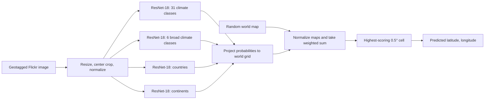
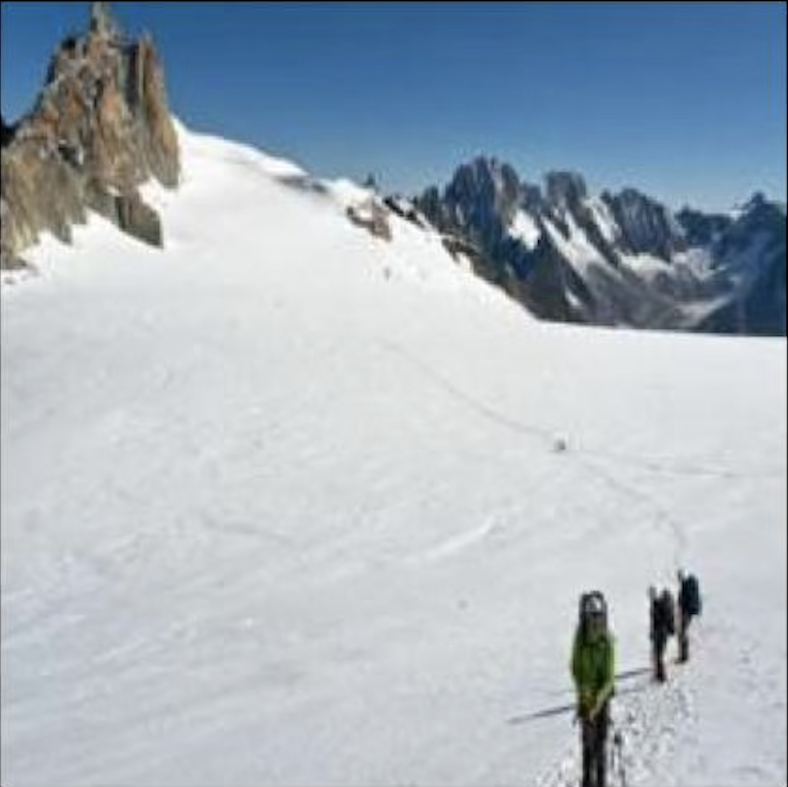
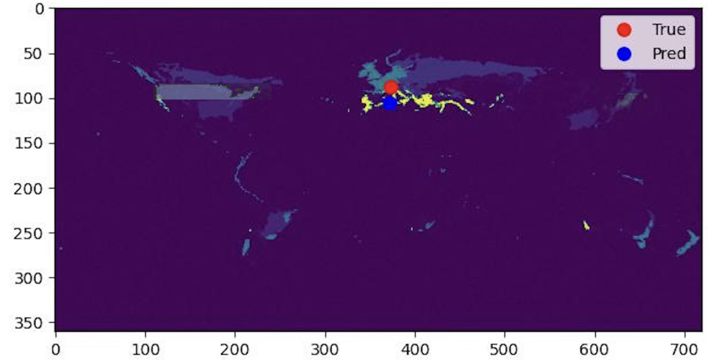
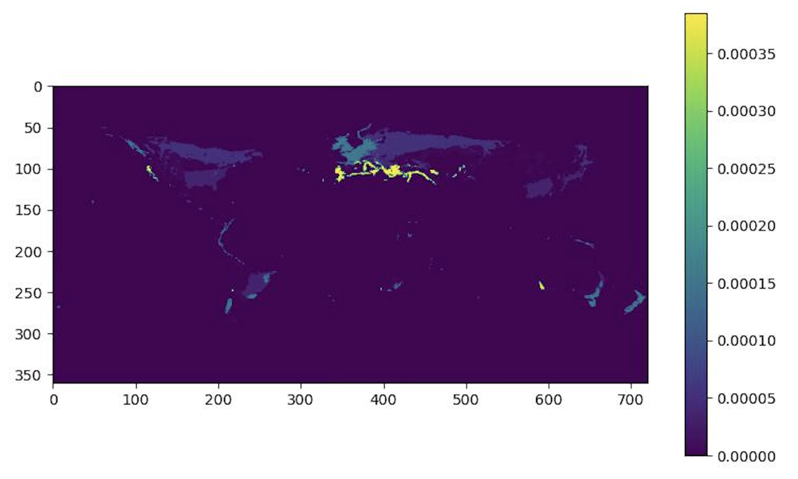
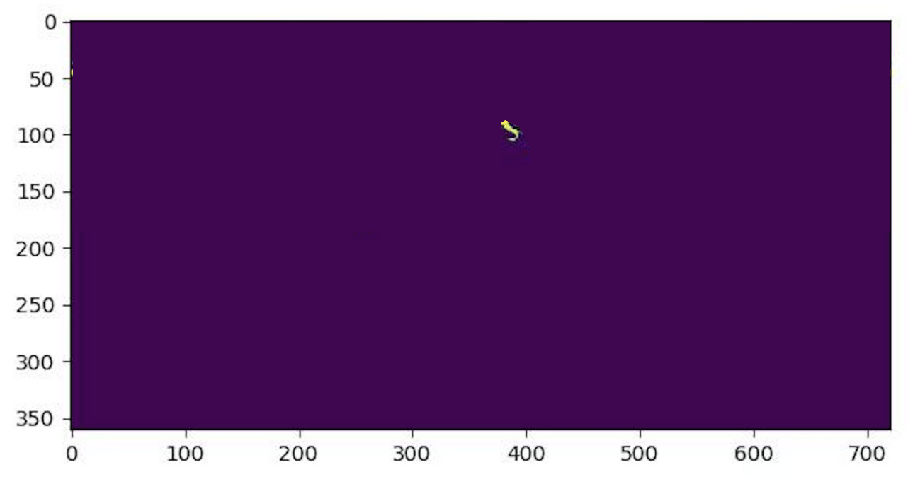

# GeoGoat

GeoGoat predicts a latitude and longitude from a geotagged photograph. It trains image classifiers for climate, country, and continent, projects their class probabilities onto a world grid, and combines the resulting maps into a location prediction. The project was developed for CSCI 1430; the [project poster](ProjectFinal_PosterTemplate.pptx) contains an overview and the example shown below.

## Architecture

| Stage | Implementation |
| --- | --- |
| Data and labels | [`gg_data.py`](gg_data.py) indexes geotagged Flickr images, saves 256 × 256 JPEGs, and joins their coordinates to Natural Earth country polygons. Climate labels come from the [Köppen–Geiger raster](https://www.gloh2o.org/koppen/) through [`models/climate.py`](models/climate.py). |
| Image features | The four classifiers in [`models/`](models/) replace the final layer of an ImageNet-pretrained ResNet-18. Input images are resized, center-cropped to 224 × 224, and normalized with ImageNet channel statistics. The detailed climate head has 30 climate classes plus ocean; the broad head groups them into five climate families plus ocean. |
| Geographic maps | Climate class scores are assigned to raster cells. Country and continent scores are assigned to cells inside their respective Natural Earth polygons. Each model therefore produces a 360 × 720 map at 0.5° resolution. |
| Fusion | [`pipeline.py`](pipeline.py) normalizes each map by its sum, adds a normalized random map as a fifth component, sums the maps with weights, and returns the center of the highest-scoring cell. The random component makes results nondeterministic. |
| Separate experiment | [`models/shadow.py`](models/shadow.py) extracts line orientations with Canny and Hough transforms and regresses **absolute** latitude. It is trained separately and is **not** an input to the current ensemble. |

The dataset split in `gg_data.py` uses a fixed PyTorch seed (`42`): 16% of indexed images for training, 2% for validation, 2% for testing, and 80% unused. The classifiers use cross-entropy loss; the default training call in `models/shared.py` runs for one epoch. The ensemble script fits softmax weights on 100 sampled training images using the negative log probability of the ground-truth grid cell and saves them in `checkpoints/ensemble.pt`.

**Current inference behavior:** `full_pipeline()` defaults to equal weights for all five maps. Although `demo/demo.py` loads `ensemble.pt`, it does not pass those learned weights to `full_pipeline()`, so the demo and generated visualizations currently use equal weights. The random map also contributes to the sum; it is not applied only when cells tie.

## Sample image predictions

This example is extracted from the project's poster. It shows one geotagged snowy mountain photo and the corresponding combined world score map. Red marks the true location; blue marks the predicted cell. Brighter map areas have higher scores. The figure does not record exact coordinates, so it should be read as an illustration rather than a numerical error measurement.

| Input photograph | Combined prediction |
| --- | --- |
|  |  |

The poster also shows two component predictions for this image:

| Climate map | Country map |
| --- | --- |
|  |  |

After training, `pipeline.py` writes visualizations for the first ten test images to `out/vis_pipeline/0.jpg` through `out/vis_pipeline/9.jpg`. Each figure includes the input, combined map with true and predicted markers, and the five component maps. Those generated images and model checkpoints are not stored in this repository.

## Quantitative results

The following are the **approximate validation results reported in the original project README**. The repository does not include the training logs or checkpoints needed to independently reproduce these numbers from a checkout.

| Model | Classes | Validation cross-entropy | Validation accuracy |
| --- | ---: | ---: | ---: |
| Detailed Köppen climate | 31, including ocean | ~2.23 | ~28% |
| Broad climate groups | 6, including ocean | ~1.04 | ~62% |

These are climate **classification** results, not coordinate accuracy. There are no recorded country or continent accuracy figures, shadow latitude errors, or held-out end-to-end distance metrics in this repository. The 100 images used to fit ensemble weights are a training sample, not an evaluation set.

## Running on Oscar

The scripts assume Brown's Oscar cluster, a CUDA-capable GPU for training and inference, a virtual environment, and data under `/users/<username>/scratch/GeoGoat/`. The dataset and trained checkpoints are not committed here. Review the `source .../bin/activate` line in each shell script before submitting jobs: some paths refer to the original authors' environments. Install [`requirements.txt`](requirements.txt) in your environment; the separate shadow experiment additionally imports `cv2` (OpenCV), which is not listed there.

1. From the repository root, create the output directory with `mkdir -p out`, then run `sbatch download.sh` to fetch the Flickr dataset, Natural Earth polygons, and Köppen–Geiger raster. The download and subsequent image indexing require substantial storage and memory.
2. Train the four image classifiers with `sbatch climate.sh`, `sbatch country.sh`, and `sbatch continent.sh`. `climate.sh` trains both detailed and broad climate models. Run `sbatch shadow.sh` only if you want the separate shadow experiment. The jobs write model files to `checkpoints/`.
3. Run `sbatch pipeline.sh` to fit and save ensemble weights and produce the ten example figures in `out/vis_pipeline/`.
4. Put a JPEG at `demo/upload.jpg`, then run `sbatch demo.sh`. The visualization is written to `out/demo.jpg`; the predicted coordinates are printed to `out/demo.out`.

The scripts expect to be launched from the repository root. `pipeline.py` loads the dataset, raster, polygons, and classifier checkpoints when imported, so the demo needs those files even for a single image.
